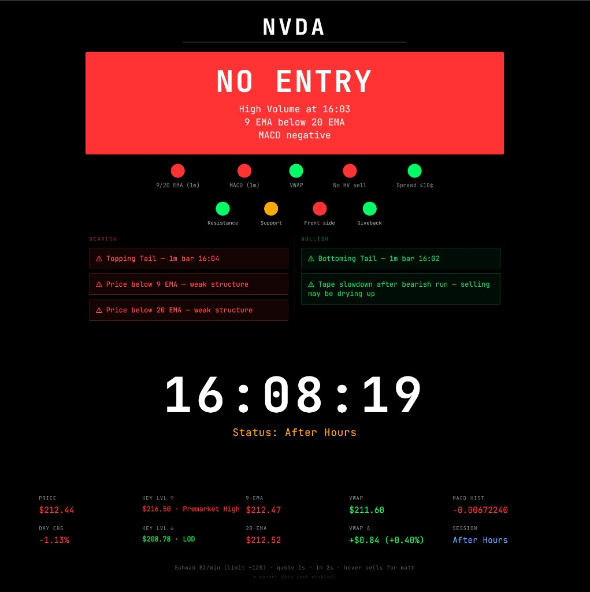

# Gatekeeper

Real-time **front-side health monitor** for a single stock symbol. Gatekeeper answers one question continuously: *Is this ticker in play right now, or should I wait?*

It is **not** a scanner, setup classifier, or order router. It is a traffic-light panel plus contextual warnings, built for momentum day trading with Schwab market data and ThinkorSwim-aligned math where it matters (VWAP, MACD, EMAs).



*Example: NVDA during after hours with NO ENTRY (row 1 failures), setup-row lights, and recent 1m warnings.*

Engineering details: [TECHNICAL_OVERVIEW.md](TECHNICAL_OVERVIEW.md)

---

## Features

### Main banner (3 states)

| State | Meaning |
|--------|---------|
| **NO ENTRY** | Any Row 1 GO check failed |
| **CAUTION** | Row 1 green; setup row (4 lights) not fully clear |
| **LOOK FOR SETUP** | Row 1 and Row 2 all green |

Row 2 issues (e.g. resistance reject) do **not** force NO ENTRY; only Row 1 failures do.

### Row 1: five GO checks

- 9 EMA > 20 EMA (1m)
- MACD histogram > 0 (1m, TOS ExpAverage)
- Price above session VWAP (4:00 AM ET anchor)
- No high-volume sell in last 8 minutes
- Bid-ask spread ≤ $0.10

### Row 2: setup row (four lights)

- **Resistance:** tri-state vs KEY LVL ↑
- **Support:** tri-state vs KEY LVL ↓
- **Front side:** buy-side structure (not a GO veto)
- **Giveback:** pullback from trailing green-run high

### Warnings (two columns)

Timed bar warnings only list times from the **last 8 minutes**. Bearish and bullish columns; high-volume sell appears under **NO ENTRY** subtext only.

### Context grid

Price, day change, VWAP and delta, 9/20 EMA, MACD hist, key levels, session label, halt status. Hover cells for calculation hints.

---

## Stack

| Layer | Technology |
|-------|------------|
| API | Node.js 24, Express 5 |
| UI | Vanilla HTML/CSS/JS (`public/index.html`) |
| Data | Schwab Market Data API, Nasdaq halt RPC |
| Deploy | Docker Compose (optional HTTPS) |

### Project layout

```
Gatekeeper/
  server.js           # Entry: HTTP server, wiring, shutdown
  routes/api.js       # REST routes
  lib/
    config.js         # Environment and tuning constants
    store.js          # Shared runtime state (cache, tokens)
    auth.js           # OAuth and token persistence
    schwab.js         # Schwab HTTP client and rate limiting
    session.js        # ET session, candles, VWAP anchor
    indicators.js     # EMA / MACD / VWAP (TOS math)
    signals.js        # Warnings, levels, traffic light
    halts.js          # Halt detection
    state.js          # Poll loop and state cache
  public/index.html   # Dashboard UI
```

---

## Requirements

- Node.js 20+ (Docker image uses Node 24)
- Schwab developer app with OAuth (Market Data production)
- `.env`: copy from [`.env.example`](.env.example)

---

## Configuration

| Variable | Purpose |
|----------|---------|
| `SCHWAB_CLIENT_ID` / `SCHWAB_CLIENT_SECRET` | OAuth |
| `PUBLIC_URL` | Base URL for OAuth redirect |
| `REDIRECT_URI` | Must match Schwab app settings (`/callback`) |
| `TOKEN_PATH` | Persisted tokens (Docker volume recommended) |
| `CERT_PATH` / `KEY_PATH` | HTTPS in production |
| `QUOTE_POLL_MS` | Schwab quote poll (default 1000) |
| `CANDLE_POLL_MS` | 1m candle poll (default 2000) |
| `STATE_POLL_MS` | Frontend state poll hint in `/api/health` |
| `DAILY_CACHE_MS` | Daily bars cache for key levels |
| `INDICATOR_1M_CACHE_MS` | MACD series cache |
| `NASDAQ_HALT_POLL_MS` | Nasdaq halt list refresh |

---

## Local development

```bash
cd Gatekeeper
npm install
cp .env.example .env   # fill in Schwab credentials
node server.js
```

Open `http://localhost:3000`, enter a symbol, and complete Schwab login at `/login` if prompted.

---

## Docker

```bash
docker compose up --build
```

Default compose maps host **443 → 3000**, mounts TLS certs and a persistent volume for tokens.

---

## API

| Endpoint | Description |
|----------|-------------|
| `GET /` | Dashboard UI |
| `GET /login`, `GET /api/login` | Schwab OAuth |
| `GET /callback` | OAuth redirect |
| `GET /api/state/:symbol` | Full state JSON (cached server-side) |
| `GET /api/health` | Auth, rate limits, poll cadence |
| `GET /api/status` | Session hours / market session |

Example `GET /api/state/AAPL` when ready: `status: ok`, `traffic_light_confirmed`, `front_side`, `level_signals`, `context`, `warnings`.

---

## Production deployment

Source is **baked into the Docker image**. Rebuild after code changes; `docker compose restart` alone does not refresh application code.

On the server (after clone, `.env`, TLS certs, and token volume are configured):

```bash
cd /path/to/Gatekeeper
docker compose up --build -d
```

If the repo is on the server with git:

```bash
./deploy.sh   # git pull && docker compose up --build -d
```

To copy files from a dev machine (no git on the host):

```bash
scp -r lib routes server.js public/index.html user@your-server:/path/to/Gatekeeper/
ssh user@your-server 'cd /path/to/Gatekeeper && docker compose up --build -d'
```

Set `PUBLIC_URL` and `REDIRECT_URI` in `.env` to your public HTTPS URL (Schwab OAuth must match).

Post-deploy smoke: see [TESTING.md](TESTING.md#production-smoke-post-deploy).

---

## Documentation

| File | Audience |
|------|----------|
| [TECHNICAL_OVERVIEW.md](TECHNICAL_OVERVIEW.md) | Engineering: architecture and operations |
| [TESTING.md](TESTING.md) | QA: TOS verification and deploy smoke |

---

## Trading hours

Extended hours monitoring: roughly **4:00 AM to 8:00 PM ET**, with pre-market data where Schwab provides it.

---

## Disclaimer

> **Disclaimer:** This project is for educational purposes only, is not affiliated with Charles Schwab, and does not constitute financial advice. Use at your own risk.

This project is not affiliated with, endorsed by, or sponsored by The Charles Schwab Corporation. All trademarks and service marks are the property of their respective owners.

**No warranty.** The software is provided "AS IS", without warranty of any kind, express or implied, including but not limited to merchantability or fitness for a particular purpose.

**Limitation of liability.** In no event shall the authors or copyright holders be liable for any financial losses, trading errors, or other damages arising from the use of this software.

**Not financial advice.** Traffic-light states, warnings, and context values are for educational and informational purposes only. They are not financial, investment, or trading advice.

**Schwab Developer API.** You are responsible for complying with Schwab's Developer API terms, rate limits, data usage policies, and authentication requirements when you run this software.

**Your deployment.** Each operator runs their own instance. You must supply your own Schwab API credentials and OAuth app configuration. Credentials and tokens are stored only on your server (`.env`, `TOKEN_PATH`); this project does not operate a hosted service and does not collect credentials from users.

---

## License

Released under the [MIT License](LICENSE).
