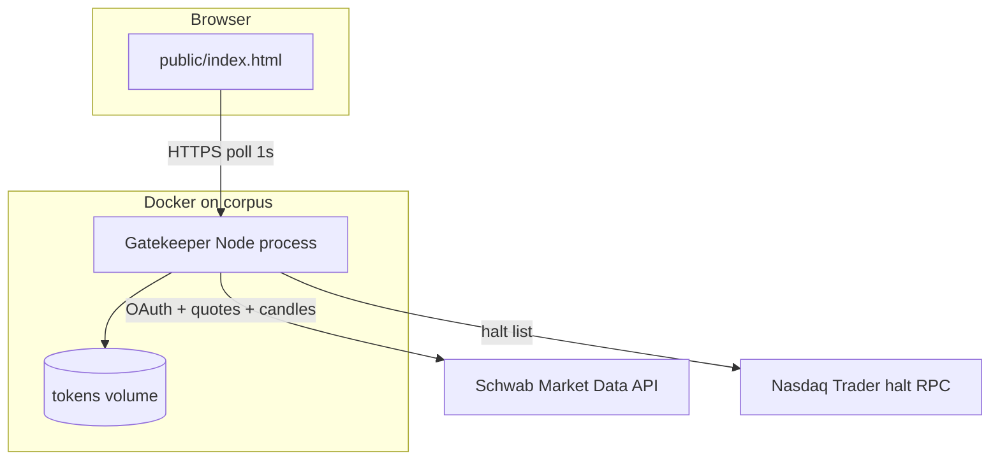
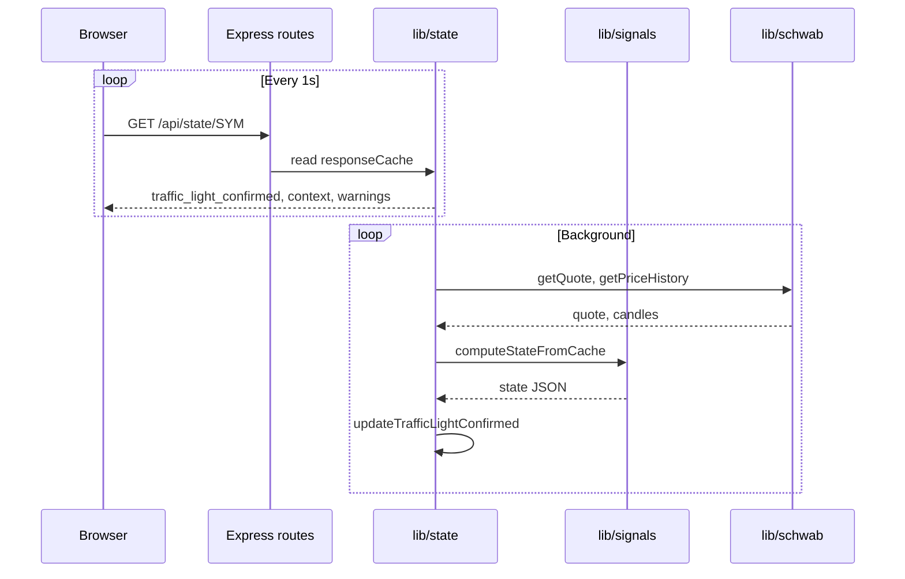

# Gatekeeper — Technical Overview

**Audience:** Engineering leadership, platform review, technical hiring discussion.  
**Companion docs:** [README.md](README.md) (operator guide), [gatekeeper-spec.md](gatekeeper-spec.md) (trading rules).

---

## 1. Executive summary

Gatekeeper is a **single-symbol, real-time market-health dashboard** for intraday momentum trading. It continuously evaluates whether a ticker is structurally eligible for long-side setup hunting (“in play”) using Schwab quotes and 1-minute candles.

**What it is**

- A read-only monitor with a three-state traffic light, five GO checks, four setup indicators, and contextual warnings.
- A small Node.js service plus static web UI, deployed in Docker with HTTPS.

**What it is not**

- Not a scanner, order router, or execution system.
- Not a backtester or portfolio tool.
- Not dependent on Level 2 or Time & Sales (tape proxies use 1m volume only).

---

## 2. Business problem

Momentum day traders need a fast, consistent answer: *Should I engage with this symbol right now?* Manual chart checks are slow and inconsistent across VWAP anchor, MACD session, and spread.

Gatekeeper standardizes that decision into:

1. **Row 1 (GO)** — structural eligibility (trend, VWAP, tape, spread).
2. **Row 2 (setup)** — location vs key levels, front-side structure, giveback.
3. **Warnings** — recent 1m bar patterns (last 8 minutes).

Only Row 1 failures force **NO ENTRY**. Row 2 issues surface as **CAUTION** so the trader can still watch for a setup.

---

## 3. System context



| Integration | Role |
|-------------|------|
| Schwab Market Data | OAuth2, NBBO quote, 1m and daily price history |
| Nasdaq Trader RPC | Supplemental halt / LUDP metadata |
| TLS certificates | Production HTTPS (mounted read-only) |

---

## 4. Runtime architecture

**Pattern:** Server-push cache, client-pull display.

The browser does not call Schwab. It polls Gatekeeper every **1 second** for `/api/state/:symbol`. The server maintains background timers:

| Timer | Default | Action |
|-------|---------|--------|
| Quote | 1s | Refresh NBBO, patch forming 1m bar |
| Candles | 2s | Refresh session 1m, indicator 1m, daily (cached) |
| Health | 30s (client) | Auth and rate-limit telemetry |
| Nasdaq halts | 60s | Refresh halt table |



**Traffic-light debouncing:** Raw banner state must be stable for **two consecutive** computations before `traffic_light_confirmed` changes. This reduces flicker on borderline GO checks.

---

## 5. Code structure

| Module | Responsibility |
|--------|----------------|
| `server.js` | Process entry, HTTPS listen, graceful shutdown, module wiring |
| `routes/api.js` | HTTP route registration |
| `lib/config.js` | Environment-backed constants |
| `lib/store.js` | Mutable runtime state (tokens, caches, timers) |
| `lib/auth.js` | OAuth, token file, proactive refresh |
| `lib/schwab.js` | HTTP client, 429 backoff, call metering |
| `lib/session.js` | ET calendar, session bars, VWAP window selection |
| `lib/indicators.js` | TOS ExpAverage EMA/MACD, VWAP |
| `lib/signals.js` | Key levels, warnings, row 1/2, calc hints |
| `lib/halts.js` | Halt / LUDP / session status line |
| `lib/state.js` | Poll orchestration, `computeStateFromCache` |

Design choice: **modular monolith** in one deployable unit—no microservices—appropriate for single-operator, single-symbol latency-sensitive use.

---

## 6. Signal pipeline (summary)

1. **Ingest** — Quote + 1m candles (session + indicator series) + daily bars for prior HOD/LOD.
2. **Normalize** — Merge sources, filter ET session day, optional gap trim on session series.
3. **Indicators** — VWAP from session anchor; EMA(9/20) and MACD(12,26,9) on indicator series (TOS ExpAverage).
4. **Row 1** — Boolean GO map: EMAs, MACD, VWAP, no HV sell (8m), spread ≤ $0.10.
5. **Row 2** — Tri-state resistance/support; front-side structure; giveback %.
6. **Warnings** — Pattern detectors on completed 1m bars in 8m window; level events merged.
7. **Output** — JSON cached per symbol; client renders.

Full thresholds and bar definitions: [gatekeeper-spec.md](gatekeeper-spec.md).

---

## 7. API contract

### `GET /api/state/:symbol`

| Field | Description |
|-------|-------------|
| `status` | `ok`, `insufficient_data`, `invalid_symbol`, `auth_failed`, `rate_limited` |
| `traffic_light_confirmed` | `NO_ENTRY`, `CAUTION`, `LOOK_FOR_SETUP` |
| `front_side` | Row 1 booleans: `emas`, `macd`, `vwap`, `no_hv_sell`, `spread_ok` |
| `level_signals` | `resistance`, `support` objects (`state`, `phase`, `reason`) |
| `momentum` | `front_side` row-2 signal |
| `giveback` | Row-2 giveback metrics |
| `warnings` | Array of warning codes |
| `warning_bars` | Map of code → ET time string |
| `context` | Price, VWAP, EMAs, MACD, key levels, session, trading_status, minute pulse, `calc_hints` |

**Not exposed** (internal or removed): `traffic_light_raw`, `rvol_daily`, legacy RVOL pipeline.

### Other endpoints

- `GET /api/health` — `authenticated`, `schwab_calls_per_min`, `poll_intervals_ms`, `rate_limit_status`
- `GET /api/status` — `session`, `open`, ETH hours label

Symbol validation: `^[A-Z][A-Z0-9.-]{0,7}$` before Schwab calls.

---

## 8. Reliability and operations

| Concern | Mechanism |
|---------|-----------|
| Token expiry | Proactive refresh 5m before expiry; refresh on 401 |
| Rate limits | Exponential backoff (5s / 10s / 20s); 429 surfaced to UI overlay |
| Stale data | Client overlays: stale (10s), disconnected (60s) |
| Deploy | `docker compose up --build -d` (image copies source; restart alone insufficient) |
| Shutdown | SIGTERM/SIGINT clears poll timers before exit |

**Verification:** [TESTING.md](TESTING.md) — corpus smoke plus ThinkorSwim manual checks.

---

## 9. Security

- Schwab secrets only in server `.env` / container env, never in the browser.
- Tokens persisted on a Docker volume (`TOKEN_PATH`), file mode `0600`.
- HTTPS termination via mounted certs in production.
- No user accounts; single-operator deployment model.

---

## 10. Design tradeoffs

| Decision | Rationale |
|----------|-----------|
| Vanilla UI vs framework | Minimal deps, fast load, single-file deploy with backend |
| Server-side polling | Schwab credentials stay server-side; one cache serves UI |
| Single symbol active | Simplifies cache and rate limits; matches workflow |
| Modular monolith vs microservices | Low ops burden; sub-100ms cache reads |
| TOS-aligned math | Trader trust; Schwab bar timestamps drive session boundaries |

---

## 11. Future extensions (not implemented)

- Level 2 / Time & Sales (noted in UI roadmap; requires paid market data).
- Multi-symbol watchlist with fair-queue polling.
- Automated regression tests against frozen candle fixtures.
- Optional WebSocket push to reduce 1s poll overhead.

---

## 12. Quick reference — data flow

```
Schwab quote (1s) ──┐
Schwab 1m (2s) ─────┼──► marketDataCache ──► computeStateFromCache()
Schwab daily (60s) ─┘         │                      │
                              │                      ├──► signals + indicators
                              │                      └──► responseCache
                              │                               │
Browser ◄── GET /api/state ◄──┴───────────────────────────────┘
```

---

*Document version aligns with post-modularization codebase (`lib/` layout) and dead-code removal (no RVOL).*
